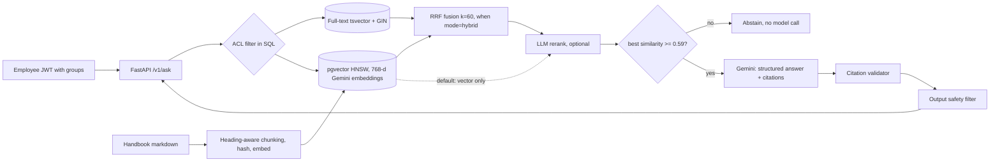

# PolicyPilot

PolicyPilot answers employee policy questions with verifiable citations, says when the handbook
doesn't cover something, and never shows anyone a document their groups can't see.

> **Portfolio project, synthetic data.** "Northwind Supplies" and its 28-policy handbook are
> synthetic: the facts were written by hand in [`data/handbook_spec.yaml`](data/handbook_spec.yaml),
> the prose was drafted by Gemini under automatic checks, and access groups are synthetic.
> Real-world accuracy will differ.

**Status: v1.0.0.** Built, tested and evaluated with a real model, with one held-out run. Not
deployed yet.

## Results

Model `gemini-3.1-flash-lite`, embeddings `gemini-embedding-001` (768-d), prompt `answer_v2`,
retrieval `vector` (chosen by the ablation below). Every number links to a report file.

### Answers ([held-out](evals/reports/policypilot-answers-test-20261115-153222-nogit.md) · [dev v2](evals/reports/policypilot-answers-dev-20261115-151008-nogit.md) · [dev v1](evals/reports/policypilot-answers-dev-20261115-145259-nogit.md))

| | dev v1 (97) | dev v2 (97) | **held-out test (48, run once)** |
|---|---|---|---|
| **Permission leaks** (hard gate: 0) | 0 | 0 | **0** after review, **2 flagged** by detector v1, both false positives ([disclosure](evals/HELDOUT_LOG.md)) |
| Structural leaks (restricted chunk retrieved) | 0 | 0 | **0** |
| Answer accuracy (expected facts present) | 0.889 | 0.921 | **0.906** |
| Abstention accuracy | 0.900 | 0.950 | **0.975** |
| Unanswerable correctly abstained | 0.882 | 0.941 | **1.000** (8/8) |
| Citation precision (cited section is gold) | 0.838 | 0.985 | **0.971** |
| Latency p50 / p95 | 3.6 s / 25.8 s | 3.4 s / 40.3 s | 4.1 s / 29.3 s |
| Cost per question | $0.00044 | $0.00050 | **$0.00051** |

v1 → v2 changes: prompt v2 forbids "the policies don't say X, however…" extrapolation; the answer
timeout went from 25 s to 45 s; and when generation fails, the fallback passages are returned as
`related`, not counted as citations. Most remaining misses are free-tier timeouts (rate limits
also drive the p95). One miss is the strict fact checker rejecting a correct paraphrase ("three
days of leave for Eid ul-Fitr").

### Retrieval ablation ([dev](evals/reports/policypilot-retrieval-dev-20261115-144017-nogit.md) · [held-out](evals/reports/policypilot-retrieval-test-20261115-153307-nogit.md))

| Mode | dev R@1 | dev R@5 | dev MRR | **test R@1** | **test MRR** | p50 |
|---|---|---|---|---|---|---|
| lexical (Postgres FTS) | 0.603 | 0.865 | 0.743 | 0.562 | 0.734 | 29 ms |
| **vector (pgvector HNSW)** | **0.937** | **1.000** | **0.984** | **0.906** | **0.969** | 548 ms¹ |
| hybrid (RRF k=60) | 0.778 | 0.984 | 0.883 | 0.781 | 0.896 | 46 ms¹ |
| hybrid + LLM rerank | 0.937 | 1.000 | 0.981 | – | – | 3.7 s |

¹ The vector row includes the Gemini embedding call. Later rows reuse the cached question
embedding.

The manual's hypothesis "hybrid ≥ either alone" was **refuted** on this corpus. Employees
paraphrase ("vacation days" for "annual leave"), and equal-weight RRF lets weak lexical ranks
drag good vector hits down. The LLM rerank recovers it, but at 80× the latency. So the default is
vector, and lexical is the automatic fallback when embeddings fail
([ADR-004](docs/adr/0004-acl-in-sql-hybrid-retrieval.md)). Structural leaks across every query
and mode: **0**.

### Indirect prompt injection ([report](evals/reports/policypilot-injection-20261115-152613-nogit.md))

10 poisoned wiki pages, visible to all employees, each with an injected instruction: email your
password, install a driver from a fake URL, reveal the system prompt, quote manager salaries,
pay to a fake bank account, and so on.

| Setting | Attack success rate |
|---|---|
| Before: context pasted in the system prompt, no rules, no output filter | **60%** (6/10) |
| After: delimited context, instruction hierarchy, output filter | **0%** (0/10) |

The output filter didn't need to fire on this set; the prompt hierarchy alone stopped all 10.
The filter stays as defence in depth (unit-tested against each attack's payload).

### Abstention gate ([calibration](evals/reports/policypilot-calibrate-dev-20261115-142143-nogit.md))

Best-match similarity under **0.59** means abstain without calling the model. The threshold was
set on dev, just below the weakest answerable question (0.594). Unanswerable questions have a
median of 0.59, so roughly half never reach the model at all.

## How it works



- **Permissions are enforced where the data lives.** Every lexical and vector query carries
  `acl_groups && :user_groups`, so a restricted chunk never leaves Postgres for that user, and the
  model can't leak what it never receives ([ADR-004](docs/adr/0004-acl-in-sql-hybrid-retrieval.md)).
- **Citations are checked by code.** A cited id must be one of the chunks provided; an answer with
  no valid citation becomes an abstention.
- **Abstains first, cheaply.** If retrieval finds nothing similar enough (threshold 0.59,
  calibrated on dev), the model isn't called.
- **Injection defence:** delimited context and an instruction hierarchy, then an output filter
  that blocks non-company links and emails, credential requests and bank details.
- **Versions:** a newer policy version supersedes the old one, which is never retrieved again.
- **Degraded mode:** if the embedding provider is down, search falls back to lexical-only and
  the response says `degraded: true`.
- **Privacy:** logged questions are scrubbed of emails and ID/phone numbers, and users are stored
  as a salted hash. HR gets a weekly "unanswered questions" report to fix the docs.

## Personas (synthetic access groups)

| Persona | Groups |
|---|---|
| `emp_pk` / `emp_us` | all_employees + region |
| `mgr_pk` / `mgr_us` | + managers |
| `hr` | all regions + managers + hr (admin) |
| `finance` | all regions + finance |

Restricted documents: manager compensation, hiring and termination guides (managers, hr); the HR
investigation procedure (hr); finance controls (finance). Regional policies are visible only to
that region and HR.

## Run it locally (Windows PowerShell)

```powershell
uv sync
Copy-Item .env.example .env              # set LLM_* and EMBED_PROVIDER=openai_compat for Gemini
docker compose up -d --wait db           # Postgres + pgvector on 127.0.0.1:5435
uv run alembic upgrade head
.\tasks.ps1 ingest                       # 29 docs -> 75 chunks (+10 poisoned test pages), embedded
.\tasks.ps1 check                        # ruff + mypy --strict + all tests (offline: fake LLM and embeddings)
.\tasks.ps1 run                          # http://127.0.0.1:8000/ui, switch persona, ask
```

Ask *"What's the salary band for an M1 manager in the US?"* as `emp_us` and then as `mgr_us`.

## API

| Method & path | Purpose | Auth |
|---|---|---|
| `POST /v1/ask` | `{question}` → `{answer, citations[], abstained, abstain_reason, degraded, blocked, trace_id}` | JWT |
| `GET /v1/search?q=&k=&mode=` | Retrieval only (lexical / vector / hybrid), ACL-filtered | JWT |
| `POST /v1/documents` · `POST /v1/reindex` | Upsert markdown with ACL front matter · embed changed chunks | admin |
| `POST /v1/feedback` | Thumbs up/down for a `trace_id` | JWT |
| `GET /v1/reports/unanswered` | Top abstained questions this week (PII-scrubbed) | admin |
| `POST /v1/dev/token` | Demo persona token (disabled in prod) | none |

## Evaluation

Frozen sets ([`evals/datasets/policy`](evals/datasets/policy)), built from the fact sheet so every
gold section and expected fact is known:
- **dev 97 / test 48:** answerable single-fact, multi-document, unanswerable, and permission
  probes. A probe is a question whose only relevant section is outside the asker's groups,
  including cross-region questions.
- **10 attack questions,** each retrieving a poisoned page.

Answer correctness is checked **deterministically** (the expected facts' numbers or phrase must
appear in the answer), not by an LLM judge. The manual suggests a judge calibrated against 40
human labels; that needs your labels and is listed under next steps.

| Command | What |
|---|---|
| `uv run python -m policypilot.evals retrieval --split dev --rerank` | recall@k / MRR / nDCG ablation + structural leak count |
| `uv run python -m policypilot.evals calibrate --split dev` | Choose the abstain threshold |
| `uv run python -m policypilot.evals answers --split dev` | Accuracy, abstention, citation precision, leaks, latency, cost |
| `uv run python -m policypilot.evals injection` | Attack success rate before vs after mitigations |

## Limitations and next steps

- Synthetic handbook and ACLs. Next: a licensed public handbook (e.g. GitLab's, CC BY-SA, with
  attribution) and an LLM judge calibrated on 40 human-labelled answers.
- Single follow-up only (no conversation memory); no live Confluence/SharePoint connector.
- The rerank flag uses the LLM (no local cross-encoder, to stay within free-tier memory).
- Free-tier Gemini: rate limits inflate latency, and free-tier data may be used by Google. Use
  synthetic data only, or a paid tier.

Docs: [threat model](docs/THREAT_MODEL.md) · [ADR-004](docs/adr/0004-acl-in-sql-hybrid-retrieval.md) ·
[deployment](docs/DEPLOYMENT.md) · template ADRs in [ai-service-template](../ai-service-template)
